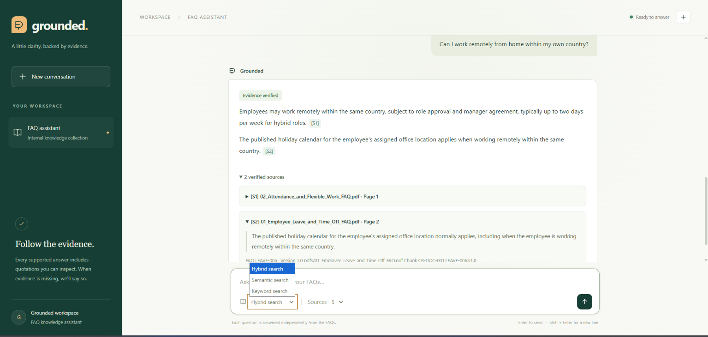
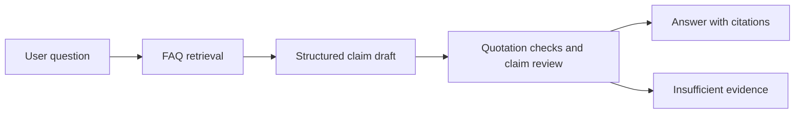

# Citation Grounding Agent

A citation-grounded FAQ assistant that answers questions from an internal knowledge collection and shows the evidence behind each claim. It combines semantic search and BM25 keyword search, generates a structured draft, and checks its supporting quotations before returning an answer.

The project includes a FastAPI chat interface built with Jinja2 templates and Tailwind CDN. Users can switch retrieval modes, inspect source quotations, and see when the available FAQ evidence is insufficient to answer a question.

## Tested chat interface



The screenshot shows a question about working remotely within the same country, an answer with claim-level citations, and expandable source cards with document names and page references.

## What the project does

- **Hybrid retrieval by default:** combines Chroma semantic search with BM25 keyword search using Reciprocal Rank Fusion.
- **Selectable search modes:** supports `hybrid`, `semantic`, and `bm25` through both the chat interface and the API.
- **Traceable claims:** connects individual statements to source quotations, FAQ IDs, document IDs, pages, and versions.
- **Evidence validation:** checks that cited chunks were retrieved, matches quotations against the original FAQ answers, and runs a separate model review of claim support.
- **Abstention when evidence is insufficient:** returns an explicit status and reason instead of displaying an unverified draft.
- **A lightweight web interface:** uses the existing grounding functions directly, with no separate frontend build.

## How an answer is produced



The LangChain agent calls `search_internal_faq` to retrieve evidence. For hybrid search, the retriever merges the semantic and keyword rankings and returns the highest-ranked FAQ chunks.

Each draft claim must reference retrieved chunk IDs and supporting quotations. The validator checks quotations against the original answers after normalizing whitespace and case, then asks the configured model to assess whether the evidence supports each claim, including conditions and exceptions. A successful result becomes a `GroundedAnswer`; an unsuccessful attempt can trigger one retry before the agent abstains.

## Getting started

### Requirements

- Python **3.12 or newer** and **uv**.
- Azure credentials available to `DefaultAzureCredential`, with access to the Azure project endpoint configured in `grounded_agent.py`.
- Access to `google/embeddinggemma-300m` for hybrid or semantic search, including any required Hugging Face authentication.
- The FAQ chunk export and a populated Chroma index for hybrid or semantic search. The repository includes the sample data and an index directory.

### Install dependencies

Run from the repository root:

```powershell
uv sync
```

### Configure the app

Create or edit `src/app/.env`:

```dotenv
OPENAI_API_KEY=replace-me
OPENAI_CHAT_MODEL=gpt-4.1-mini
FAQ_CHUNKS_PATH=data/faqs/faq_chunks.json
FAQ_DB_PATH=data/chroma_embeddinggemma
FAQ_EMBEDDING_DEVICE=cpu
```

**Authentication in the current implementation:** the agent uses `DefaultAzureCredential` and an Azure endpoint defined in [grounded_agent.py](src/citation_grounding_agent/grounded_agent.py). The FastAPI app still requires a nonempty `OPENAI_API_KEY` for its setup check, but that value does not replace Azure authentication. `OPENAI_CHAT_MODEL` selects the model or deployment name passed to the configured endpoint.

FAQ paths are relative to the repository root; absolute paths also work. Shell environment variables take precedence over `.env`. Restart the server after changing environment settings.

### Start the server

```powershell
uv run uvicorn app.main:app --app-dir src --reload
```

- Chat interface: <http://127.0.0.1:8000>
- Interactive API documentation: <http://127.0.0.1:8000/docs>
- Basic setup check: <http://127.0.0.1:8000/health>

The retriever and embedding model load on the first relevant request, so the first hybrid or semantic search can take longer. Subsequent requests reuse the cached retriever.

### Build an index when needed

If the default Chroma index is missing or needs populating, use the existing indexing module:

```powershell
uv run python -m citation_grounding_agent.vectore_store
```

This reads `data/faqs/faq_chunks.json`, indexes it into the `cedarbridge` collection under `data/chroma_embeddinggemma`, and uses CPU embeddings by default. The chat endpoints do not automatically rebuild the index.

## API usage

Send a JSON request to `POST /api/chat`:

```json
{
  "question": "Can I work remotely from home within my own country?",
  "mode": "hybrid",
  "k": 5
}
```

PowerShell example:

```powershell
$body = @{
    question = "Can I work remotely from home within my own country?"
    mode = "hybrid"
    k = 5
} | ConvertTo-Json

Invoke-RestMethod -Uri "http://127.0.0.1:8000/api/chat" -Method Post -ContentType "application/json" -Body $body
```

| Parameter | Required | Default | Description |
| --- | --- | --- | --- |
| `question` | Yes | — | A nonblank question, up to 4,000 characters. |
| `mode` | No | `hybrid` | One of `hybrid`, `semantic`, or `bm25`. |
| `k` | No | `5` | An integer from 1 to 20, forwarded to the agent as the retrieval count. The retry can retrieve additional candidates. |

### Search modes

| Mode | Retrieval method | Embeddings required |
| --- | --- | --- |
| `hybrid` | Semantic search and BM25, merged with Reciprocal Rank Fusion | Yes |
| `semantic` | Chroma vector similarity search | Yes |
| `bm25` | Keyword search over the FAQ chunks | No |

### Response fields

The API returns the existing [GroundedAnswer](src/citation_grounding_agent/schemas.py) contract:

| Field | Meaning |
| --- | --- |
| `status` | `answered` or `insufficient_evidence`. |
| `evidence_status` | `supported` for an accepted answer; `low` when the agent abstains. |
| `answer` | The final answer text with citation labels, or the abstention message. |
| `claims` | Individual statements and their supporting citation IDs. |
| `citations` | Citation IDs, chunk and FAQ IDs, document IDs, source paths, pages, versions, and quotations. |
| `reason` | An explanation when sufficient verified evidence could not be established. |

`GET /health` checks source syntax, API-key presence, the FAQ file, and the default hybrid index file. It does not initialize the embedding model, verify Azure permissions, or check the collection contents.

## Sample knowledge base

The included dataset represents **Cedarbridge Systems**, a fictional company used for citation-grounding experiments. It contains **6 source PDFs, 36 FAQs, and 36 evidence chunks** across these areas:

- Employee Leave & Time Off
- Attendance & Flexible Work
- IT Accounts & Security
- Travel & Expenses
- Purchasing & Equipment
- Information Classification & Privacy

Each FAQ becomes one evidence chunk. Original answers and citation metadata are preserved alongside the search text. The sample policies are fictional training data.

## Project structure

```text
.
├── src/
│   ├── app/
│   │   ├── main.py                   # FastAPI routes and request parameters
│   │   ├── templates/chat.html       # Jinja2 chat page
│   │   ├── static/                   # Browser behavior and styling
│   │   └── tests/test_main.py        # HTTP boundary tests
│   └── citation_grounding_agent/
│       ├── models.py                 # FAQ dataset and evidence chunk models
│       ├── faq_loader.py             # Dataset loading and validation
│       ├── faq_chunker.py            # FAQ-to-chunk conversion
│       ├── document_adapter.py       # LangChain documents and metadata
│       ├── bm25_retriever.py         # Keyword retrieval
│       ├── vectore_store.py          # Embeddings and Chroma indexing
│       ├── hybrid_retriever.py       # Search modes and rank fusion
│       ├── grounded_agent.py         # Evidence tool and structured generation
│       ├── citation_validator.py     # Quote checks and claim review
│       └── schemas.py                # Draft and public answer contracts
├── data/
│   ├── faqs/                         # Source PDFs, FAQ records, and chunks
│   └── chroma_embeddinggemma/         # Persisted Chroma index
├── script/build_faq_dataset.py       # PDF-to-FAQ dataset extraction
├── tested-answer.png                 # Tested chat screenshot
└── pyproject.toml                    # Project dependencies and configuration
```

## Endpoint tests

```powershell
uv run pytest src/app/tests -q -p no:cacheprovider
```

The endpoint tests substitute the agent at the HTTP boundary. They check request validation, retrieval-mode forwarding, defaults, citation preservation, insufficient-evidence responses, and setup errors without making model API calls or loading embeddings. Live integration testing also requires working Azure credentials and a usable index.

## Current behavior

Each question is answered independently; the visible conversation is not passed back as model history. Chat messages remain in the current browser page and disappear on refresh or when starting a new conversation.

Citation checks and model review reduce unsupported output, but a `supported` result represents this validation process rather than a guarantee of correctness. The interface displays final answers after validation. Tailwind is loaded from a CDN, so its styling requires internet access.
